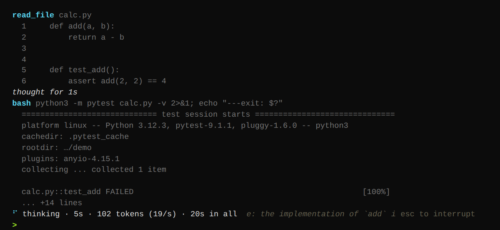

# frank

The agent, in the terminal or the browser. It talks to any OpenAI-compatible
chat endpoint that supports tool calling (llama.cpp, vLLM, Ollama) and gives
the model the tools a coding agent needs: a shell with a persistent working
directory, file read, write and edit, glob and grep, web fetch, a task list and
read-only subagents.

From a checkout:

    uv sync
    uv run frank --doctor            # models, context window, speed, tool-call check
    uv run frank                     # interactive session in the current directory
    uv run frank -p "explain the build"            # one shot
    git diff | uv run frank -p "review this"       # piped input
    uv run frank -y "fix the failing test"         # auto-approve tool calls
    uv run frank --web                             # the chat page, on the same sessions

Without a checkout, on any machine that can reach the Spark, the control page
gives a command that installs frank from the Spark itself with `uvx`. It only
needs `FRANK_BASE_URL` and `FRANK_API_KEY`: the model defaults to the first
one the server lists, and the kind of server is detected.

Permissions: read-only tools always run. In `ask` mode a shell command runs
without a prompt only if it is obviously harmless (ls, git status, rg and so
on, or a prefix listed in `allowed_commands`); everything else asks, with an
"always for this tool" answer that lasts the session. `-y` approves everything,
`--readonly` removes the writing tools entirely. Non-interactive runs deny what
they cannot ask about, so pass `-y` when piping.

Thinking: `--effort` (or `/effort` in a session) takes `off`, `low`, `medium`,
`high` or `max`; the default is `max`. What that does depends on the model.
A model with a reasoning mode of its own (Qwen3.8, DeepSeek V4, GLM-5,
Laguna, Nemotron, gpt-oss and others) thinks natively and the server returns
it as `reasoning_content`. Each family names its levels differently, so the
agent translates: Qwen3.8 gets `xhigh` for `high` and `max`, DeepSeek V4 and
GLM-5 get `max`, gpt-oss gets `high`, and models that only switch thinking on
or off get no level at all. If a server still refuses the value,
the agent drops it for that model and carries on with the model's default. A
model without a reasoning mode gets a section in the system prompt that asks
for a `<think>` block at the start of every response, with instructions that
get more demanding at each level, and the client lifts the block out of the
stream. Either way the thinking is hidden unless you pass `--think`, it comes
before tool calls, and it stays in the history the model sees. `thinking` in
the config forces one kind when the guess from the model name is wrong, and
`--doctor` checks that thinking and a tool call arrive in the same response.

Context: the agent reads the context window from the server and scales to it.
One tool result may take about a tenth of the window, so with 1M tokens whole
files and long logs come back uncut. When usage passes `compact_threshold` the
agent asks for a continuation summary at the end of the real conversation,
where the server already has the prefix cached, and replaces the history with
it. The system prompt is built once per session for the same reason: anything
that changes it, including `/effort` on a model that is prompted to think,
makes the server process the whole history again.

Sessions are JSONL files under `.frank/sessions/`; `-c` or `--resume` (no id)
resumes the latest for the current directory, `-r ID` a specific one, and
`--sessions` lists them.

In the terminal the conversation prints into the terminal itself, so
scrollback, search and copying work as they always do, and quitting leaves it
there. Only finished lines are printed; the line being written shows under the
conversation until it is done. Below that a status line says what is going on:
waiting for the model, the server reading the prompt (how far, how much was
cached, how long is left), thinking (for how long, how many tokens, and the
latest bit of the reasoning), writing, or the tool that is running. Thinking
leaves a "thought for 40s" line behind; `--think` or `/think` shows all of it.

Esc or Ctrl-C stops a turn, and Ctrl-D on an empty line exits. A message typed
while a turn runs asks whether it goes later (when the turn ends), as the next
instruction (now), or as a clarification; Alt+Enter sends it as a
clarification straight away. A permission question takes y, n or a (always for
this tool), or a sentence, which says no and goes to the model as what to do
instead.

Timeouts: `request_timeout` (300 s) is how long the agent waits for the next
byte from the server. llama.cpp is asked for progress while it reads a prompt,
which arrives every few seconds even for a cold million tokens, so only a stuck
server runs into it; vLLM and Ollama send nothing until the first token, so
raise it there if a long cold prompt needs more. A shell command gets
`bash_timeout` (120 s) unless the model asks for longer, up to 600.

`frank --web` serves the same sessions as a chat page in the browser, on
http://127.0.0.1:8089 (`--host` and `--port` change that; `web_host` and
`web_port` in the config too). Chats started there are sessions like any other,
and terminal sessions show up there as chats. Each chat runs its agent in a
process of its own, in the project folder picked for it, which reads the config
there the way the terminal would; the flags given to `frank --web` still win.
Stop on the page works like Ctrl-C. Permission questions come up as Allow,
Always and Deny, and slash commands work in the message box. A turn holds a
lock on its session, so the terminal and the page never write to one at the
same time, and each picks up what the other added before its next request.
Prompts typed on the page go into the same Up-arrow history as the terminal's.
There is no login: anyone who can open the page can have the agent run
commands as you, which is why it stays on 127.0.0.1 unless told otherwise.

Prompts live in `frank_local/prompts/`: `system.md` (the agent's standing
orders, with `{placeholders}` for the environment), `user.md` (the
user's standing instructions; put your own in `user.local.md`, which replaces
it and is ignored by git), `thinking.md` (the `<think>` protocol and one section
per effort level), `subagent.md`, `compact.md` and `tools.md` (one section
per tool, parsed into the tool descriptions the model sees). Edit them freely;
nothing else needs to change.

Instruction files are appended to the system prompt: `~/.claude/CLAUDE.md`,
then `AGENTS.md`, `CLAUDE.md`, `.claude/CLAUDE.md`, `CLAUDE.local.md` and
`FRANK.md` in the working directory and each of its parents, outermost first.
They are read when a session starts and again after a compaction or `/clear`,
which cost the server its cache anyway, so an edit made during a session
holds from the next one of those. Asked to remember something for later
sessions, the agent adds it to the project's `CLAUDE.md`.

Slash commands in the session: `/help`, `/compact`, `/clear`, `/tokens`,
`/model`, `/effort`, `/think`, `/yolo`, `/tools`, `/todos`, `/cwd`, `/system`.

Licensed under the PolyForm Noncommercial License 1.0.0; see `LICENSE.md` in the repository root.
